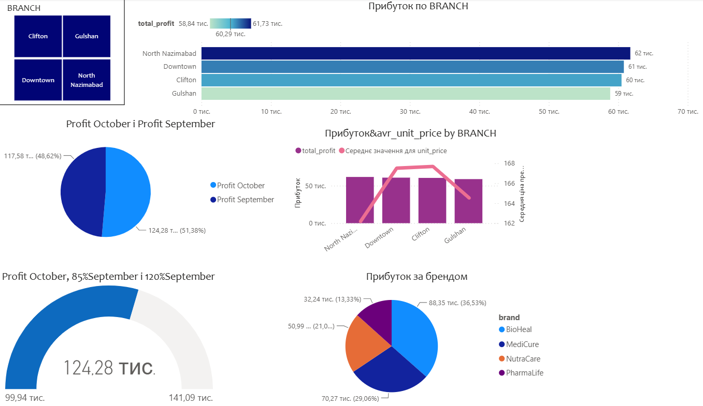
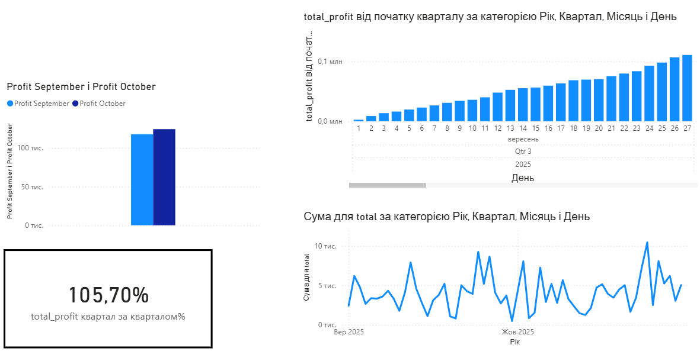
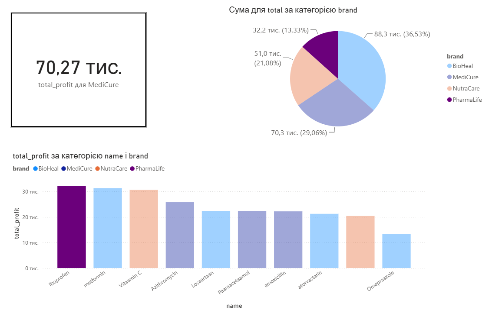
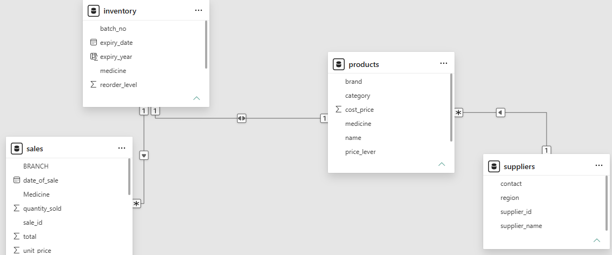
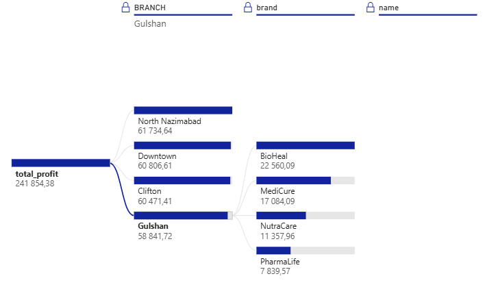

# Pharmacy Sales Analytics Dashboard (Power BI)

Interactive Power BI report analyzing sales of a pharmacy chain: revenue dynamics, branch and brand performance, and product contribution.

## Overview

**Goal.** Turn raw sales, product, supplier and inventory CSV files into a clean data model and a report that answers: how are sales changing, which branches and brands drive revenue, and which products contribute most.

**Data.** 289 sales transactions (1 Sep – 30 Oct 2025), 4 branches, 10 products, 4 brands, 10 suppliers, plus inventory. Educational dataset.

## Key Insights

- **Revenue grew 5.7%** in October vs September (124.3K vs 117.6K) with almost the same number of transactions (144 vs 145).
- **Branches perform almost equally.** North Nazimabad 61.7K, Downtown 60.8K (25.1% of total), Clifton 60.5K, Gulshan 58.8K. The gap between best and worst branch is under 5%.
- **Brands.** BioHeal 36.5%, MediCure 29.1%, NutraCare 21.1%, PharmaLife 13.3%.
- **Prescription drugs account for 54%** of revenue (131.4K vs 110.5K for over-the-counter).
- **Top products:** Ibuprofen (32.2K), Metformin (31.3K), Vitamin C (30.6K).

## Data Preparation (Power Query)

- Fixed data types and decimal separators; removed blank rows and rows with errors
- Trimmed and cleaned text fields (IDs, names, branches)
- Standardized categories ("OTC" → "Over-the-Counter"), fixed negative cost prices
- Filtered out suppliers with invalid contact numbers
- Added conditional column `reorder_needed` (stock below reorder level or expired batch)

## Data Model

One fact table (`sales`) and three dimension tables (`products`, `suppliers`, `inventory`).

## Report Pages

| Page | What it shows |
|---|---|
| Month comparison | September vs October revenue, daily and cumulative trend |
| Brands | Brand share of revenue, revenue by product and brand |
| Branches | Branch share, Downtown vs Clifton comparison |
| Decomposition tree | Revenue broken down by branch → brand → product |
| KPI | October revenue against September-based targets (85% / 120%) |

